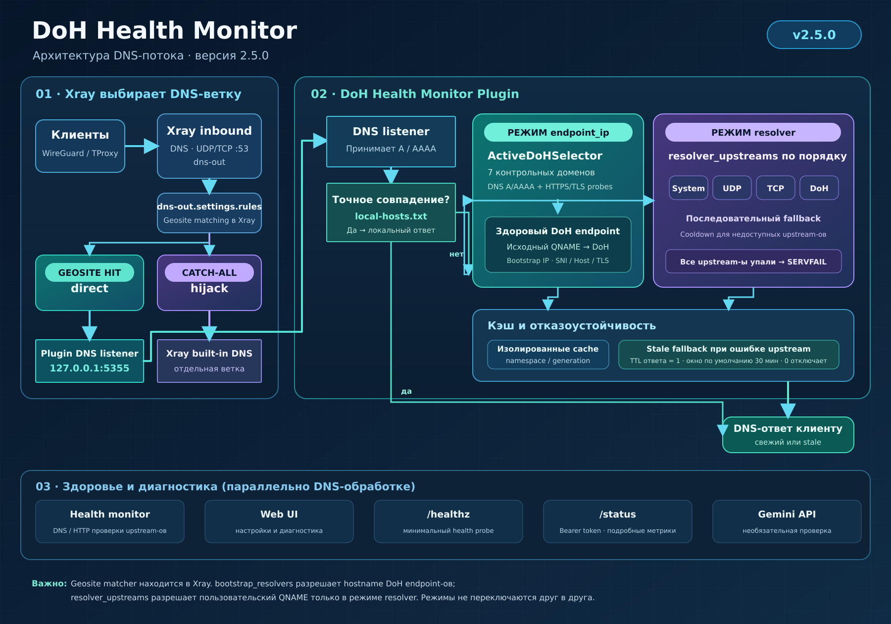

# DoH DNS Proxy & Health Monitor для LucX-UI

**Версия:** 2.5.0  
**Платформа:** Linux x86-64 (`amd64`), статический Go-бинарник  
**Тип:** LucX-UI sidecar, `apiVersion: 1`  
**Режим Gemini API:** необязательный, управляется параметром `gemini_api.enabled`

## Навигация по README

<details open>
<summary><strong>Оглавление разделов</strong></summary>

- [1. Назначение](#1-назначение)
  - [Что умеет](#что-умеет)
  - [Где настраивается Geosite](#где-настраивается-geosite)
  - [Чего плагин не делает](#чего-плагин-не-делает)
- [2. Схема работы](#2-схема-работы)
- [3. Состав пакета и расположение файлов](#3-состав-пакета-и-расположение-файлов)
  - [Проверка происхождения релизного ZIP](#проверка-происхождения-релизного-zip)
- [4. Установка в LucX-UI](#4-установка-в-lucx-ui)
  - [SSH-меню и Web UI](#ssh-меню-и-web-ui)
  - [Управление жизненным циклом через LucX-UI API](#управление-жизненным-циклом-через-lucx-ui-api)
    - [Автозапуск при загрузке VPS](#автозапуск-при-загрузке-vps)
    - [Авторизация и защита API](#авторизация-и-защита-api)
    - [Удаление плагина и автономная установка](#удаление-плагина-и-автономная-установка)
  - [Daemon health and status API](#daemon-health-and-status-api)
  - [Требования по архитектуре и сети](#требования-по-архитектуре-и-сети)
- [5. Конфигурация плагина](#5-конфигурация-плагина)
  - [5.1 `config.json`](#51-configjson)
  - [5.1.1 Режимы Geosite DNS в линейке 2.3.x](#511-режимы-geosite-dns-в-линейке-23x)
    - [Listener-ы и общие параметры](#listener-ы-и-общие-параметры)
  - [5.1.2 Локальные DNS-переопределения `local-hosts.txt`](#512-локальные-dns-переопределения-local-hoststxt)
  - [5.2 Health-check и ActiveDoHSelector](#52-health-check-и-activedohselector)
  - [5.3 DNS cache](#53-dns-cache)
  - [5.4 DoH endpoints и bootstrap](#54-doh-endpoints-и-bootstrap)
  - [5.5 Полный список health-check в `tst-domen.txt`](#55-полный-список-health-check-в-tst-domentxt)
  - [5.6 Автоматическое создание, контроль изменений и config.json](#56-автоматическое-создание-контроль-изменений-и-configjson)
  - [5.7 Необязательная проверка Gemini API](#57-необязательная-проверка-gemini-api)
- [6. Подключение к панели / Xray](#6-подключение-к-панели-xray)
  - [Проверка утверждённой схемы](#проверка-утверждённой-схемы)
  - [Отключённые операции изменения Xray](#отключённые-операции-изменения-xray)
- [7. Проверка работы](#7-проверка-работы)
  - [7.1 Health endpoint](#71-health-endpoint)
  - [7.2 Подробный статус](#72-подробный-статус)
  - [7.3 Проверка локального DNS по UDP](#73-проверка-локального-dns-по-udp)
  - [7.4 Проверка TCP DNS](#74-проверка-tcp-dns)
  - [7.5 Проверка реального DNS пути через Xray](#75-проверка-реального-dns-пути-через-xray)
  - [7.6 Проверка failover](#76-проверка-failover)
  - [7.7 Проверка изменения настроек](#77-проверка-изменения-настроек)
- [8. Журналы и диагностика](#8-журналы-и-диагностика)
- [9. Безопасность](#9-безопасность)
- [10. Остановка, откат и удаление](#10-остановка-откат-и-удаление)
  - [Откат DNS до старой конфигурации](#откат-dns-до-старой-конфигурации)
  - [Удаление и повторная установка](#удаление-и-повторная-установка)
- [11. Сборка из исходников](#11-сборка-из-исходников)
- [12. Ограничения текущей реализации](#12-ограничения-текущей-реализации)
- [13. Ссылки на документацию](#13-ссылки-на-документацию)
- [14. Локальные DNS-переопределения: `local-hosts.txt`](#14-локальные-dns-переопределения-local-hoststxt)
  - [Формат файла](#формат-файла)
  - [Миграция старых настроек](#миграция-старых-настроек)
  - [Редактирование и применение](#редактирование-и-применение)
  - [DNS-поведение](#dns-поведение)
  - [Проверка через dig](#проверка-через-dig)

</details>


## 1. Назначение

DoH Health Monitor — локальный DNS sidecar для LucX-UI/Xray. В линейке 2.3.x обработка Geosite DNS-потока разделена между Xray и плагином: Xray сопоставляет QNAME с Geosite и выбирает DNS-ветку, а плагин обслуживает только те запросы, которые Xray направляет в его DNS listener. В самом плагине нет собственного Geosite matcher и динамической базы пользовательских QNAME.

Плагин поддерживает два взаимоисключающих режима обработки A/AAAA запросов:

- **`endpoint_ip` (режим по умолчанию):** ActiveDoHSelector выбирает здоровый DoH endpoint по семи контрольным доменам. Плагин отправляет исходный DNS-запрос выбранному endpoint-у и возвращает полноценный ответ для запрошенного домена (A/AAAA, включая CNAME и DNSSEC/EDNS-данные ответа). Соединение закрепляется за bootstrap IP endpoint-а, при этом сохраняются исходное имя хоста, TLS SNI, проверка сертификата и HTTP Host. Это режим для Xray Geosite DNS path.
- **SmartDNS selection (опционально, `smartdns_enabled: true`):** после получения A/AAAA ответа в режиме `endpoint_ip` плагин проверяет до восьми публичных адресов через HTTPS с исходным QNAME в SNI/Host, выбирает адрес с минимальной успешной задержкой и переписывает адресные записи DNS-ответа на него (без перестройки DNS-пакета и смещения compression pointers). Проверки идут по обычному сетевому маршруту VPS, не через Xray/VLESS/Reality. Если адрес не прошёл проверку, ответ не переписывается. При DNSSEC AD или запросе с EDNS DO ответ также остаётся неизменным, поскольку переписывание нарушило бы DNSSEC. Флаг по умолчанию выключен для полной обратной совместимости.
- **`resolver`:** плагин разрешает исходное имя запроса через независимый упорядоченный список `resolver_upstreams`. По умолчанию используется системный resolver ОС сервера; можно настроить UDP, TCP и DoH upstream-ы.

Обычная DNS-ветка listener-а принимает A и AAAA. Для точно совпавшего имени из управляемого `local-hosts.txt` плагин возвращает настроенные локальные A/AAAA; HTTPS/SVCB и остальные неподдерживаемые QTYPE получают `NOERROR`/NODATA без SOA и без кэширования. CNAME RR в составе ответа upstream на A/AAAA сохраняются.

`bootstrap_resolvers` и `resolver_upstreams` — разные настройки: первые разрешают hostname DoH endpoint-ов для исходящих соединений самого плагина, вторые выполняют обычный DNS resolve пользовательского QNAME только в режиме `resolver`.

[↑ К меню](#навигация-по-readme)

### Что умеет

- UDP и TCP DNS listener по умолчанию на `127.0.0.1:5355`; конфигурация принимает только loopback IP literals и валидные порты 1–65535.
- DNS UDP payload учитывает EDNS buffer size клиента (или 512 байт без EDNS); при нехватке места ответ обрезается по границе RR и получает флаг TC.
- ActiveDoHSelector: семь контрольных доменов, A/AAAA DNS probes через кандидатов DoH, затем HTTPS/TLS probes по IP с исходными hostname, SNI, HTTP Host и проверкой сертификата. При равном health score учитывается EWMA успешных end-to-end probe durations (alpha=0.3); latency-only переключение требует одновременно не менее 25% и 100 мс выигрыша, двух последовательных циклов и соблюдения minimum-hold/switch-cooldown.
- Режим `endpoint_ip` пересылает исходный A/AAAA DNS-запрос через выбранный ActiveDoH endpoint; соединение закреплено за его bootstrap IP, а hostname/SNI/сертификат сохраняются. Ответ содержит реальные DNS-записи запрошенного домена; TTL исходного ответа сохраняется, кэш ограничивается настройками cache (по умолчанию максимум 300 секунд).
- Stale cache работает в обоих режимах и включается только при ошибке upstream. В `endpoint_ip` отдельная копия ответа хранится в пределах поколения конфигурации, независимо от поколения выбора endpoint-а: после сбоя или отзыва выбора можно вернуть последний известный ответ с TTL=1 в течение `cache.stale_ttl_seconds`. При наличии stale-ответа клиент получает его в пределах 1.8 секунды; после fallback повторный запрос того же QNAME/QTYPE подавляется на 2 секунды. В `resolver` stale-ответ из namespace текущего поколения resolver-а возвращается с TTL=1, если все upstream-ы завершились ошибкой; ожидание ограничено обычным `dns_query_timeout_seconds`, отдельного 1.8-секундного таймера в этом режиме нет. По умолчанию окно stale — 30 минут; `0` отключает механизм. Успешный свежий ответ всегда имеет приоритет. Если DoH-провайдер в `endpoint_ip` вернул валидный SERVFAIL, он может кратковременно кэшироваться отдельно (не более 5 секунд, управляется `negative_ttl_seconds`); синтетические ошибки и усечённый SERVFAIL не кэшируются.
- В `endpoint_ip` структурно корректные `SERVFAIL` и `REFUSED` допускают не более одной повторной попытки на другом bootstrap IP; если второй адрес тоже не даёт пригодного ответа, клиент получает последний DNS-ответ провайдера без подмены на синтетический SERVFAIL. Ответы с флагом `TC` продолжают проверяться через остальные bootstrap IP. При транспортной/HTTP-ошибке следующий IP запускается сразу, а если попытка просто медленная — через адаптивную задержку 1.5× медианы фактической latency bootstrap IP (100–1500 мс; fallback 250 мс до накопления измерений; не более одной параллельной hedge-попытки на DNS-запрос); первый пригодный ответ побеждает, остальные попытки отменяются. `NXDOMAIN` и другие корректные DNS-ответы не повторяются. Ошибка DNS policy не запускает selector probes; внеочередная проверка запускается только после транспортных ошибок и не чаще раза в 30 секунд. Это не переключает ActiveDoHSelector на другой provider и не меняет его anti-flap policy.
- Режим `resolver` с последовательным fallback через system, UDP, TCP и DoH upstream-ы; упавшие upstream-ы получают cooldown, а отказ всех upstream-ов возвращает DNS SERVFAIL вместо ложного NODATA.
- Раздельные cache namespace/generation для двух режимов; режим 2 использует positive cache TTL не более 300 секунд и SOA-based negative caching по RFC 2308.
- Сохранение исходного TTL upstream в первом ответе; ограничения TTL применяются к отдельной копии, помещаемой в кэш.
- Независимые bootstrap DNS для разрешения hostname DoH endpoint-ов.
- Существующий health monitor upstream-ов, DNS/HTTP проверки и необязательная Gemini API проверка.
- `/healthz` — минимальный неаутентифицированный health probe; подробный `/status` требует bearer-токен из приватного файла `status-api.token`.
- Приём и журналирование событий LucX-UI через Unix socket.
- Интерактивный Web UI для поддерживаемых настроек и диагностики; доступ через SSH-туннель.

[↑ К меню](#навигация-по-readme)

### Где настраивается Geosite

Geosite matching находится в правилах внутри Xray DNS outbound (`dns-out.settings.rules`), а не в обычных routing rules и не в плагине. Запросы, совпавшие с Geosite, направляются действием `direct` на `127.0.0.1:5355`; остальные передаются действием `hijack` встроенному DNS Xray. Для этого нужен routing rule, отправляющий DNS-трафик TCP/UDP порта 53 в `dns-out`.

[↑ К меню](#навигация-по-readme)

### Чего плагин не делает

- Не загружает и не разбирает Geosite assets, не поддерживает собственный matcher и не ведёт динамическую QNAME database.
- Не определяет по одному DNS-пакету, какое правило Xray совпало; разделение потоков должно произойти до передачи пакета listener-у.
- Не обслуживает отдельные QTYPE HTTPS/SVCB, MX, TXT и другие типы; для них listener возвращает NODATA.
- Плагин не выполняет самостоятельную DNSSEC validation; DO/CD и DNSSEC-данные передаются через DoH, а AD определяется ответом выбранного resolver-а. Локальные hosts-ответы не устанавливают AD.
- Не меняет Xray DNS policy при обычном запуске daemon. Geosite rules настраиваются вручную; автоматические CLI/Web UI операции изменения Xray отключены в линейке 2.3.x, поскольку прежний planner не соответствует этой схеме.
- Не отключает проверку TLS-сертификатов и hostname.

[↑ К меню](#навигация-по-readme)

## 2. Схема работы

Ниже показан полный путь DNS-запроса: от маршрутизации в Xray до ответа выбранного режима плагина.



Сопоставление Geosite и выбор DNS-ветки выполняет Xray: `Geosite HIT → direct → 127.0.0.1:5355` попадает в плагин, а `catch-all → hijack` остаётся на встроенном DNS Xray. Внутри listener сначала проверяется точное совпадение в `local-hosts.txt`, затем запрос обрабатывается одним из взаимоисключающих режимов.

В `endpoint_ip` плагин пересылает исходный A/AAAA запрос выбранному здоровому DoH серверу и возвращает DNS-ответ исходного QNAME. Bootstrap IP нужен только для подключения к DoH endpoint; он не подменяет адрес запрошенного домена. В `resolver` исходный QNAME разрешается через отдельный список `resolver_upstreams`. Это независимые режимы: при ошибке одного режима нельзя переключаться в другой.

`rewriteNetwork: udp` в DNS outbound определяет транспорт локального участка Xray → plugin listener. Для текущей схемы используется UDP; это не описание внешнего транспорта WireGuard.

Системный resolver ОС в режиме `resolver` не означает встроенный DNS Xray. Необходимо проверить `/etc/resolv.conf` и сетевые перенаправления, чтобы исключить DNS-петлю через локальный stub, TProxy или NAT.

[↑ К меню](#навигация-по-readme)

## 3. Состав пакета и расположение файлов

Установочный ZIP содержит необходимые для установки файлы и скрипты управления:

```text
manifest.json
bin/doh-health-monitor
scripts/
├── plugin-management.sh
└── check-dns-integration.sh
```

`plugin-management.sh` запускает SSH-меню, а `check-dns-integration.sh` используется его read-only диагностикой. `README.md` и каталог `examples/` остаются в GitHub-репозитории, но в установочный ZIP не включаются. Автоматического обновления плагина нет: новую версию устанавливают повторно через менеджер плагинов.

После первого запуска в приватной папке `$LUCX_PLUGIN_DATA` автоматически создаются:

```text
$LUCX_PLUGIN_DATA/
├── config.json       # генерируемая рабочая конфигурация + прочие настройки
├── doh-servers.txt   # ID провайдера и URL DoH, одна запись на строку
├── tst-domen.txt     # DNS/HTTP health-check настройки, одна проверка на строку
└── local-hosts.txt   # точные DNS-переопределения, одна запись на hostname
```

При настройке `webDomain` для доступа к panel API SSH-меню дополнительно создаёт необязательный файл `panel-api-host` с правами `0600`.
Если `gemini_api.enabled` включён, дополнительно создайте:

```text
$LUCX_PLUGIN_DATA/gemini_api_key
```

Вся изменяемая информация хранится только в `LUCX_PLUGIN_DATA`. Плагин не должен писать в каталог бинарника, `/etc`, `/tmp` или другие места.

[↑ К меню](#навигация-по-readme)

### Проверка происхождения релизного ZIP

Для каждого релиза публикуются ZIP, файл SHA-256 и GitHub artifact attestation (Sigstore). Проверяйте **оба** свойства: checksum подтверждает целостность скачанного файла, attestation — репозиторий и workflow, которые его собрали.

Для релиза `v2.5.0` после скачивания обоих файлов выполните:

```bash
sha256sum -c doh-health-monitor-v2.5.0.zip.sha256
gh attestation verify doh-health-monitor-v2.5.0.zip \
  --repo agentnht/doh-health-monitor \
  --signer-workflow agentnht/doh-health-monitor/.github/workflows/release.yml
```

Для проверки нужен GitHub CLI с поддержкой `gh attestation verify`. Не запускайте архив, если любая из проверок завершилась ошибкой. Attestation подтверждает происхождение и целостность артефакта, но сама по себе не является гарантией безопасности программы.

[↑ К меню](#навигация-по-readme)

## 4. Установка в LucX-UI

1. Для опубликованного релиза скачайте ZIP с соответствующим номером версии. Для релиза `v2.5.0` используйте пакет `doh-health-monitor-v2.5.0.zip` со страницы GitHub Releases.
2. В LucX-UI откройте менеджер плагинов и установите ZIP.
3. Запустите плагин из панели.
4. При первом запуске плагин создаст `config.json`, `doh-servers.txt`, `tst-domen.txt` и `local-hosts.txt`. Уже существующие текстовые файлы не перезаписываются (старый URL-only список DoH автоматически мигрирует в новый формат). Если `local-hosts.txt` отсутствует, старые записи `local_hosts` из `config.json` однократно переносятся в новый файл.
5. Посмотрите журнал плагина. Нормальный старт содержит строки примерно такого вида:

```text
level=INFO START id=doh-health-monitor version=2.5.0 arch=amd64 data=...
level=INFO CONFIG loaded ... gemini_api=false
level=INFO EVENT_SOCKET listening ...
level=INFO READY DNS=127.0.0.1:5355/127.0.0.1:5355 HTTP=127.0.0.1:18765
```

6. Запустите Web UI через SSH-меню и откройте его по адресу локального SSH-туннеля. В интерфейсе доступны редакторы поддерживаемых параметров `config.json`, `doh-servers.txt`, `tst-domen.txt` и `local-hosts.txt`.

[↑ К меню](#навигация-по-readme)

### SSH-меню и Web UI

После установки плагина доступны два способа запуска меню.

**Способ 1 — локальный скрипт из установленного ZIP (рекомендуется).**

При стандартном расположении LucX-UI подключитесь к VPS по SSH и выполните от root:

```bash
bash /usr/local/x-ui/bin/plugins/doh-health-monitor/scripts/plugin-management.sh
```

Если LucX-UI установлен в другом каталоге, замените путь на фактический каталог установленного плагина. При первом запуске локальной копии скрипт создаст симлинк `/usr/local/bin/dhm`. После этого меню можно запускать короткой командой:

```bash
dhm
```

Существующий файл или ссылка `/usr/local/bin/dhm`, если они указывают на другой объект, не перезаписываются. После удаления самого плагина удалите оставшуюся ссылку командой `rm -f /usr/local/bin/dhm`.

**Получение архива для установки или обновления.**

Не запускайте management script непосредственно через `curl | bash` или process substitution: такой путь не позволяет проверить целостность исполняемого файла до запуска. Для установки/обновления скачивайте опубликованный release ZIP и checksum, проверяйте архив и только затем устанавливайте его через штатный менеджер LucX-UI:

```bash
version=2.5.0
asset="doh-health-monitor-v${version}.zip"
base="https://github.com/agentnht/doh-health-monitor/releases/download/v${version}"
curl -fSLO "$base/$asset"
curl -fSLO "$base/$asset.sha256"
sha256sum -c "$asset.sha256"
```

После успешной проверки SHA-256 установите ZIP через LucX-UI. Для ежедневного управления используйте локальную копию menu script из установленного каталога плагина (Способ 1); не запускайте скрипты из непроверенного URL от root.

Если вы подключились не под root, сначала выполните `sudo -i`, затем запустите установленное меню.

Меню предоставляет следующие действия:

1. **Проверить состояние** — автоматически определяет активный менеджер процесса (LucX-UI или standalone systemd), проверяет службу, DNS-listener-ы и `/healthz`, затем выполняет read-only проверку утверждённого Xray Geosite DNS path.
2. **Запустить Web UI** — интерфейс управления плагином и read-only диагностики, доступный через SSH-туннель.
3. **Переключить DNS mode / настроить resolver upstreams** — интерактивное изменение режима и списка resolver upstreams с подтверждением.
4. **Управление через LucX-UI API и автозапуск** — запустить, остановить или перезапустить плагин через штатный Plugin Manager API панели; включить или отключить автоматический запуск при загрузке VPS.
0. **Выход**.

Web UI содержит:
- **Конфигурация** — редактор поддерживаемых параметров listeners, таймаутов, health, cache, bootstrap resolvers и Gemini API; для изменения listener-портов интерфейс сообщает о необходимости перезапуска.
- **DoH-сервера** и **Домены** — редакторы `doh-servers.txt` и `tst-domen.txt`, сохраняющие порядок строк и состояние включения/отключения.
- **Local hosts** — редактор `local-hosts.txt`: точный hostname и списки IPv4/IPv6, комментарии и отключённые строки сохраняются. Запись изменяется только в DNS-плагине; системный `/etc/hosts` не затрагивается. Перед записью создаётся `local-hosts.txt.bak` (0600), а файл атомарно заменяется. Проверенные изменения автоматически применяются демоном после hot reload; интервал задаётся `reload_interval_seconds` (1–300 секунд, встроенное значение по умолчанию — 5 секунд). Изменение адресов listener-ов и `dns_max_concurrent` сохраняется, но применяется после перезапуска плагина; остальные настройки и source-файлы продолжают hot reload.
- **Проверка состояния** — проверки конфигурации, файлов, портов и реальные DNS-запросы к настроенному UDP listener с отображением домена, типа записи, ответа и времени.
- **Логи** — ограниченный просмотр журнала плагина.

Web UI не содержит кнопок изменения Xray-конфигурации. Настройка Geosite DNS выполняется вручную через штатный редактор панели по нормативному design doc.

Доступ к Web UI начинается с одноразового bootstrap-токена, который SSH-меню выводит вместе с локальным URL. Первый запрос атомарно обменивает билет на HttpOnly/SameSite cookie и очищает токен из адресной строки; повторное использование билета отклоняется. Каждый Web UI API-запрос требует сессионную cookie; дополнительно проверяются Host/Origin. Интерфейс слушает только loopback и предназначен для доступа через SSH local port forwarding. Не пересылайте bootstrap URL и не публикуйте вывод SSH-меню. Ключ Gemini сохраняется в отдельный файл с правами `0600`, его содержимое не возвращается браузеру.

[↑ К меню](#навигация-по-readme)

### Управление жизненным циклом через LucX-UI API

Пункт **4) Управление через LucX-UI API и автозапуск** использует штатные endpoint-ы менеджера sidecar-плагинов LucX-UI:

- `GET /panel/api/plugins/doh-health-monitor/status` — получить состояние;
- `POST /panel/api/plugins/doh-health-monitor/start` — запустить;
- `POST /panel/api/plugins/doh-health-monitor/stop` — остановить;
- `POST /panel/api/plugins/doh-health-monitor/restart` — перезапустить.

DNS-процесс остаётся под управлением Plugin Manager панели. Скрипт не запускает бинарник напрямую и не подменяет panel supervisor. Поэтому Start, Stop и Restart в интерфейсе LucX-UI управляют тем же экземпляром, что и команды SSH-меню. Ручной Stop в панели действительно останавливает daemon.

[↑ К меню](#навигация-по-readme)

#### Автозапуск при загрузке VPS

Подменю пункта 4 позволяет отдельно включить или выключить автозапуск. При включении устанавливается один вспомогательный unit `doh-health-monitor-panel-autostart.service` типа `oneshot`:

- Unit запускается после `x-ui.service` и `network-online.target`.
- Он вызывает установленный `plugin-management.sh` в специальном режиме. Скрипт ждёт готовности локального API, проверяет статус плагина и отправляет `start`, только если плагин остановлен.
- После успешной команды helper завершается. Он **не является владельцем DNS-процесса**, не проверяет его по таймеру и не отменяет ручной Stop из панели.
- Если включён автозапуск, после следующей перезагрузки VPS плагин будет запущен. Остановка через панель действует до следующей загрузки VPS.
- Отключение автозапуска удаляет helper-unit, но не останавливает уже работающий daemon. Для остановки нажмите Stop в панели или выберите соответствующее действие в SSH-меню.

При переходе с прежнего standalone режима пункт 4 отключает и удаляет старые `doh-health-monitor.service` и `doh-health-monitor-healthcheck.timer`, чтобы не оставалось двух независимых менеджеров одного процесса. Включать standalone service параллельно с управлением через Plugin Manager нельзя.

[↑ К меню](#навигация-по-readme)

#### Авторизация и защита API

Helper работает от root и получает отдельный временный Bearer API token через локальный CLI панели (`x-ui setting`). Для доступа к `/plugins` требуется scope `admin`; restricted scopes `monitor` и `node-sync` для lifecycle API недостаточны. Токен не берётся из пароля администратора и не хранится постоянно:

- для каждого запуска helper выпускает/ротирует токен с зарезервированным именем;
- plaintext находится в памяти процесса и во временном curl config в `/run` с правами `0600`;
- после API-вызовов токен удаляется через API панели; при ошибке helper ротирует зарезервированный token slot через локальный CLI;
- все API-запросы направляются на IP/порт локального интерфейса панели; proxy для curl отключён. Для локального HTTPS используется `--insecure`, поскольку сертификат панели часто не выпущен на loopback IP.

Не меняйте вручную токен с именем `doh-health-monitor-plugin-management`, пока SSH-меню выполняет API-операцию. Не делайте `plugin-management.sh` и каталог плагина доступными на запись посторонним пользователям: скрипт кратковременно использует административные права API. Пароль администратора панели в файлах не сохраняется.

Если в настройках LucX-UI задан `webDomain`, глобальный DomainValidator проверяет HTTP Host даже для локальных API-запросов. В этом случае перед использованием API выберите пункт 4 → **7) Настроить webDomain (Host) для API панели** и укажите точное значение домена без `https://` и порта. Скрипт продолжит соединяться с локальным IP панели, но добавит `Host: <webDomain>:<port>`. Значение сохраняется в `$LUCX_PLUGIN_DATA/panel-api-host` с правами `0600`; DNS-запрос к внешнему домену и внешний сетевой доступ для API не требуются. Если `webDomain` не настроен, оставьте override пустым.

[↑ К меню](#навигация-по-readme)

#### Удаление плагина и автономная установка

Перед удалением или переустановкой плагина выключите API-автозапуск через пункт 4 → **Отключить автозапуск**. Это удалит unit, который ссылается на установленный `plugin-management.sh`. Затем остановите плагин и удалите его штатным способом из менеджера LucX-UI.

API-автозапуск требует работающий LucX-UI и установленный sidecar. Для полностью автономного сервера без панели используйте отдельный systemd unit, который запускает бинарник напрямую с `LUCX_PLUGIN_DATA`; API-режим SSH-меню в такой конфигурации неприменим. Не включайте одновременно самостоятельный unit и управление процессом через LucX-UI.

Web UI по-прежнему запускается отдельно из SSH-меню и завершается при закрытии управляющей SSH-сессии.

[↑ К меню](#навигация-по-readme)

### Daemon health and status API

- `GET /healthz` открыт для локального health-check LucX-UI и возвращает только `ok` (HTTP 200). Никакие адреса, счётчики, upstream-ы или настройки через него не раскрываются.
- `GET /status` содержит подробное состояние daemon и доступен только с `Authorization: Bearer <token>`. Случайный 256-bit токен создаётся при каждом старте daemon и хранится в `$LUCX_PLUGIN_DATA/status-api.token` с правами `0600`; файл находится в каталоге данных с правами `0700`. Токен заменяется атомарно при рестарте.
- Web UI backend читает этот файл без перехода по symlink и сам добавляет bearer-заголовок при запросе daemon. Токен не передаётся браузеру. Read-only shell checker использует тот же защищённый локальный файл.
- Не копируйте и не публикуйте `status-api.token`. Для обычной проверки доступности используйте `/healthz`, а не подробный `/status`.


При запуске Web UI меню напечатает готовую SSH-команду для Windows PowerShell и локальный URL с одноразовым bootstrap-токеном. Оставьте открытыми управляющую SSH-сессию и отдельную сессию туннеля. Нажмите Enter в управляющей сессии, чтобы остановить Web UI и вернуться в меню; при закрытии SSH-сессии Web UI также завершается.

Скрипт рассчитан на уже установленный плагин. Он не устанавливает и не обновляет сам плагин, не открывает порты в firewall и не изменяет UFW.

[↑ К меню](#навигация-по-readme)

### Требования по архитектуре и сети

- Этот ZIP содержит бинарник только `linux/amd64`.
- `permissions.network` пустой массив: плагину разрешена сеть для DoH и HTTPS health-check. Не устанавливайте `network: ["none"]`.
- `panelApi` grant не запрашивается и admin credential панели не используется. Плагин не изменяет Xray-конфигурацию; Geosite DNS policy настраивается оператором вручную.
- Listener-ы по умолчанию привязаны только к `127.0.0.1`; другие значения допускаются только как IP loopback literal (`127.0.0.1`, `::1` и т.п.), не `0.0.0.0` и не hostname.
- Bootstrap IP DoH endpoint-ов фильтруются: частные, loopback, link-local, multicast, documentation и прочие non-global адреса не используются.
- `/status` не раскрывает filesystem path каталога конфигурации, системный список DNS и ошибки чтения resolv.conf; URL выбранного DoH endpoint-а публикуется только как origin без path/query.

[↑ К меню](#навигация-по-readme)

## 5. Конфигурация плагина

[↑ К меню](#навигация-по-readme)

### 5.1 `config.json`

Это генерируемый рабочий файл. Плагин обновляет из текстовых источников `upstreams`, `groups[].upstreams`, `groups[].checks` и `local_hosts` (из `local-hosts.txt`); остальные настройки — DNS listeners, Bootstrap DNS, резервные IP, тайминги, пороги, кэш и Gemini API — сохраняются. Поле `integration` из прежней модели больше не управляет Xray и игнорируется для Geosite DNS policy.

Образец `examples/config.example.json` доступен в GitHub-репозитории, но не входит в ZIP. При первом старте плагин создаёт реальный `config.json` из встроенного шаблона. Обычно достаточно редактировать созданный файл.

[↑ К меню](#навигация-по-readme)

### 5.1.1 Режимы Geosite DNS в линейке 2.3.x

> DNS architecture и management smoke tests введены в `v2.3.0`; defaults обновлены в `v2.3.1`; исправления надёжности DNS, Web UI и локальной security boundary включены в `v2.3.2` и перечислены в `CHANGELOG.md`.

В новой модели `dns_mode` выбирает ровно один способ обработки запросов, пришедших на DNS listener плагина:

| Значение | Поведение |
|---|---|
| `endpoint_ip` (default) | ActiveDoHSelector выбирает здоровый DoH endpoint по семи контрольным доменам. Исходный A/AAAA запрос отправляется этому endpoint-у; клиент получает DNS-ответ запрошенного домена. Bootstrap IP используется только для соединения с DoH. |
| `resolver` | Плагин разрешает исходное QNAME через список `resolver_upstreams` в заданном порядке. Это обычный DNS resolve запрошенного имени. |

Пример настройки режима 2:

```json
{
  "dns_mode": "resolver",
  "resolver_upstreams": [
    { "id": "system", "name": "System resolver (OS)", "type": "system" },
    { "id": "quad9-udp", "name": "Quad9 UDP", "type": "udp", "address": "9.9.9.9" },
    { "id": "cloudflare-tcp", "name": "Cloudflare TCP", "type": "tcp", "address": "1.1.1.1:53" },
    {
      "id": "quad9-doh",
      "name": "Quad9 DoH",
      "type": "doh",
      "url": "https://dns.quad9.net/dns-query",
      "bootstrap_ips": ["9.9.9.9"]
    }
  ]
}
```

Типы upstream-а:

- `system` — системный resolver ОС сервера; nameserver-ы читаются из `/etc/resolv.conf`.
- `udp` / `tcp` — обычный DNS upstream. `address` должен быть IP literal; порт необязателен и по умолчанию равен 53. Hostname здесь не принимается.
- `doh` — HTTPS DoH endpoint. Задаётся через `url`; `bootstrap_ips` необязателен и содержит IP literal для подключения без предварительного разрешения hostname.

Порядок объектов в `resolver_upstreams` задаёт fallback-порядок. Следующий upstream пробуется при транспортной ошибке/таймауте, SERVFAIL, REFUSED или непригодном усечённом ответе. Валидный NXDOMAIN или NOERROR/NODATA считается окончательным DNS-ответом и не маскируется следующим upstream-ом. Если все upstream-ы исчерпаны, плагин возвращает синтетический SERVFAIL и не кэширует его; если для этого QNAME/QTYPE есть stale-запись в пределах окна, возвращается она с TTL=1.

Если `resolver_upstreams` отсутствует или имеет значение `null`, применяется default — один system resolver. Явный пустой массив `[]` означает, что upstream-ов нет; в режиме `resolver` запросы завершатся синтетическим SERVFAIL (или stale-ответом, если он есть в пределах настроенного окна). Чтобы отключить system resolver, укажите непустой список других upstream-ов или явно задайте нужный порядок.

`bootstrap_resolvers` — отдельная настройка для bootstrap hostname-ов DoH endpoint-ов. Она не является списком пользовательских DNS upstream-ов режима 2 и не подменяет `resolver_upstreams`.

**QTYPE и TTL:** listener плагина обслуживает A и AAAA. Другие типы DNS-запросов получают NOERROR/NODATA без SOA и без кэширования. CNAME RR, пришедшие в составе ответа на A/AAAA от upstream-а, сохраняются. В режиме `endpoint_ip` первый ответ сохраняет TTL, полученный от выбранного DoH; отдельная копия для кэша ограничивается 300 секундами и временем жизни записи. Смена выбранного endpoint-а очищает кэш. В режиме `resolver` положительный cache TTL ограничен 300 секундами; NXDOMAIN/NODATA кэшируется только при наличии SOA и с TTL по RFC 2308, ограниченным сверху 300 секундами. Первый ответ клиенту сохраняет upstream TTL, а cap применяется к отдельной копии для кэша.

[↑ К меню](#навигация-по-readme)

#### Listener-ы и общие параметры

```json
{
  "dns_listen_udp": "127.0.0.1:5355",
  "dns_listen_tcp": "127.0.0.1:5355",
  "http_listen": "127.0.0.1:18765",
  "reload_interval_seconds": 5,
  "dns_query_timeout_seconds": 15,
  "doh_timeout_seconds": 10,
  "dns_max_concurrent": 256
}
```

| Параметр | Назначение | Ограничения/значение по умолчанию |
|---|---|---|
| `dns_listen_udp` | UDP DNS listener | `127.0.0.1:5355` |
| `dns_listen_tcp` | TCP DNS listener | `127.0.0.1:5355` |
| `http_listen` | HTTP status listener | `127.0.0.1:18765` |
| `reload_interval_seconds` | Интервал hot reload: проверка `config.json` и текстовых источников (1–300 с) | 5 секунд; при недопустимом значении используется 30 секунд |
| `dns_query_timeout_seconds` | Общий таймаут DNS-запроса | 15 секунд, диапазон 1–120 |
| `doh_timeout_seconds` | Таймаут одного DoH запроса | 10 секунд, диапазон 1–60 |
| `dns_max_concurrent` | Лимит одновременных DNS запросов | 256, диапазон 1–4096 |

**Перезапуск самого плагина требуется**, если меняются `dns_listen_udp`, `dns_listen_tcp`, `http_listen` или `dns_max_concurrent`. Остальные параметры `config.json` и оба текстовых источника применяются автоматической перезагрузкой; `doh-servers.txt` и `tst-domen.txt` проверяются с интервалом `reload_interval_seconds` (по умолчанию 5 секунд). При изменении `http_listen` также измените `health.target` в manifest и переустановите плагин, иначе probe панели продолжит обращаться к прежнему адресу.

[↑ К меню](#навигация-по-readme)

### 5.1.2 Локальные DNS-переопределения `local-hosts.txt`

Файл управляет только локальными DNS-ответами плагина. Он не является системным hosts-файлом и не меняет `/etc/hosts`, маршрутизацию Xray, firewall или TProxy.

Формат: `hostname;IPv4[,IPv4...];IPv6[,IPv6...]`, одна запись на hostname. Пустое поле IPv4 или IPv6 допустимо; суммарно требуется хотя бы один адрес. Пример:

```text
# hostname;ipv4[,ipv4...];ipv6[,ipv6...]
nas.home.arpa;192.0.2.10;fd00::10
printer.home.arpa;192.0.2.20,192.0.2.21;
```

Поддерживаются точные DNS-имена; wildcard и произвольные пути не принимаются. Hostname нормализуется к нижнему регистру без завершающей точки. Допускается до 1000 записей и до 16 IPv4 и 16 IPv6 адресов на hostname. Проверяются корректность hostname, семейство IP и дубли. Пустые строки и строки комментариев `#` сохраняются; отключить запись можно флажком в Web UI — строка станет комментарием, не удаляясь.

При первом запуске, если `local-hosts.txt` ещё нет, существующий `local_hosts` из старого `config.json` переносится в новый файл. Если файл уже существует, он является единственным источником истины; содержимое `config.json` будет синхронизировано при загрузке/перезагрузке конфигурации.

Web UI создаёт `local-hosts.txt.bak` с правами `0600` перед атомарной заменой. Демон проверяет хэш файла вместе с остальными источниками с интервалом `reload_interval_seconds` (по умолчанию 5 секунд). Некорректное содержимое отвергается целиком: последний рабочий runtime snapshot остаётся активным, а причина отображается в status/log.

[↑ К меню](#навигация-по-readme)

### 5.2 Health-check и ActiveDoHSelector

Обычный health monitor продолжает собирать DNS/HTTP/OIDC результаты по группам `config.json`. Он показывает состояние upstream-ов и не является тем же механизмом, что ActiveDoHSelector.

ActiveDoHSelector режима `endpoint_ip` независимо оценивает настроенные DoH endpoint-ы по семи контрольным доменам: `chatgpt.com`, `claude.ai`, `gemini.google.com`, `elevenlabs.io`, `grok.com`, `www.perplexity.ai` и `aistudio.google.com`. Для каждого кандидата выполняются A/AAAA запросы через проверяемый DoH, затем HTTPS/TLS probes напрямую к IP сайта с исходным hostname/SNI/Host и проверкой сертификата.

Selector использует freshness, score, failure grace cycles, minimum hold и switch cooldown для снижения flapping. Системный resolver не является кандидатом ActiveDoHSelector: он может использоваться отдельно в `resolver_upstreams` режима 2.

Настройки `health.interval_seconds`, `failure_threshold` и `success_threshold` относятся к существующему health monitor и не заменяют политику ActiveDoHSelector. Новый DNS-запрос в режиме `resolver` выполняет собственный последовательный fallback по списку `resolver_upstreams`.

[↑ К меню](#навигация-по-readme)

### 5.3 DNS cache

Одинаковые одновременные DNS-запросы в рамках одного режима и generation объединяются: только первый запрос обращается к upstream, остальные ожидают его результат. Перед отправкой каждому клиенту восстанавливается его исходный DNS transaction ID. При смене ActiveDoH selection или resolver generation запросы не объединяются между разными поколениями.


```json
"cache": {
  "enabled": true,
  "min_ttl_seconds": 0,
  "max_ttl_seconds": 300,
  "negative_ttl_seconds": 15,
  "stale_ttl_seconds": 1800,
  "max_entries": 8192,
  "max_bytes": 8388608
}
```

- `enabled`, `max_entries` и `max_bytes` управляют общим RAM-кэшем.
- `stale_ttl_seconds` (0–3600, по умолчанию 1800) задаёт окно использования недавно истёкшего ответа **только при ошибке upstream**. Такой ответ отдаётся с TTL=1; если upstream доступен, истёкшая запись не используется.
- В режиме `endpoint_ip` первый ответ сохраняет upstream TTL; TTL отдельной кэш-копии ограничивается 300 секундами. Кэш привязан к generation выбранного endpoint-а и очищается при переключении.
- В режиме `resolver` положительный cache TTL ограничен сверху 300 секундами; исходный TTL первого ответа upstream не изменяется.
- Для NXDOMAIN и NODATA с SOA negative TTL равен `min(SOA RR TTL, SOA.MINIMUM)`, с верхней границей 300 секунд. Это включает NODATA после CNAME chain: CNAME RR сохраняются, но срок negative-кэша конечного QNAME определяется SOA.
- Отрицательные ответы без пригодной SOA, TTL=0, SERVFAIL/REFUSED и синтетический NODATA при исчерпании upstream-ов не кэшируются. `negative_ttl_seconds` не используется как fallback TTL в режиме `resolver`.
- При чтении TTL уменьшается на прошедшее время. Пространства кэша режимов 1 и 2 независимы; generation защищают от повторного наполнения кэша старыми запросами после переключения конфигурации.

Кэш находится в RAM и очищается при перезапуске плагина. Смена выбранного DoH endpoint-а влияет на cache режима `endpoint_ip`, но сама по себе не сбрасывает cache режима `resolver`.

[↑ К меню](#навигация-по-readme)

### 5.4 DoH endpoints и bootstrap

`doh-servers.txt` содержит настроенные upstream-ы и DoH URL в формате `стабильный_ID;HTTPS_URL`. Эти DoH URL используются существующей health-monitor моделью и как кандидаты ActiveDoHSelector режима `endpoint_ip`; системный DNS не рассматривается selector-ом как DoH endpoint.

Для каждой DoH hostname плагин получает bootstrap A/AAAA через независимые `bootstrap_resolvers` (по умолчанию `1.1.1.1` и `8.8.8.8`). Bootstrap IP нужны для соединения с DoH endpoint-ом; они не разрешают пользовательские QNAME.
`resolver_upstreams` режима `resolver` — отдельный список. Он не читается из `doh-servers.txt` и задаёт собственный упорядоченный набор `system`, `udp`, `tcp` и `doh` upstream-ов. Если поле отсутствует или равно `null`, используется один system resolver. Явный пустой массив `[]` означает, что upstream-ов нет.

Пример строк `doh-servers.txt`:

```text
# id;url
system-dns;
geohide-eu;https://eu.geohide.ru/dns-query
dagami;https://dns.dagami.ru/dns-query
comss-one;https://dns.comss.one/dns-query
bezmezhau;https://dns.bezmezhau.com/dns-query
zapret;https://dns.zapret.moe/dns-query
pereval;https://free.pereval.top/dns-query
```

Новая установка по умолчанию включает `pereval` с URL `https://free.pereval.top/dns-query`. Порядок строк по-прежнему влияет на существующие upstream groups. ActiveDoHSelector выбирает DoH endpoint по результатам контрольных DNS/HTTPS/TLS probes и своей anti-flap политике; не следует трактовать `system-dns` как fallback-кандидата selector-а.

Старый URL-only `doh-servers.txt` и hostname-based IDs поддерживают предусмотренную в проекте миграцию. Изменения конфигурации проходят валидацию и применяются через runtime snapshot.

[↑ К меню](#навигация-по-readme)

### 5.5 Полный список health-check в `tst-domen.txt`

Файл управляет всеми параметрами проверок. Каждая строка содержит шесть полей:

`domain;qtypes;required;http_url;expected_status;verify_oidc`

Пример:

```text
# domain;qtypes;required;http_url;expected_status;verify_oidc
play.google.com;A,AAAA;0;;;0
gemini.google.com;A,AAAA;1;https://gemini.google.com/;200;0
accounts.google.com;A,AAAA;1;https://accounts.google.com/.well-known/openid-configuration;200;1
```

| Поле | Назначение |
|---|---|
| `domain` | Контрольное доменное имя |
| `qtypes` | DNS-типы через запятую: `A`, `AAAA`, `TXT`, `HTTPS`, `65` и т. д. Проверяются по порядку до первого успешного ответа |
| `required` | `1` — обязательная проверка, `0` — диагностическая |
| `http_url` | Необязательный HTTPS URL. Пустое поле означает только DNS |
| `expected_status` | Допустимые HTTP-коды через запятую, например `200,301,302`. Пустое поле означает стандартный диапазон 2xx/3xx |
| `verify_oidc` | `1` — проверить OIDC issuer в JSON discovery response, `0` — не проверять |

Пустые строки и комментарии, начинающиеся с `#`, игнорируются. Домены должны быть уникальными. HTTP URL должен использовать HTTPS и тот же hostname, что и поле `domain`. Для `verify_oidc=1` URL должен оканчиваться на `/.well-known/openid-configuration`.

**HTTP выполняется только при непустом `http_url`.** Флаг `required` не включает и не выключает саму пробу: он определяет только влияние результата на общий статус upstream. Ошибка необязательной DNS/HTTP-проверки видна в диагностике, но не переводит upstream в `down`.

Встроенный `tst-domen.txt` содержит девять проверок: семь контрольных доменов ActiveDoHSelector (`chatgpt.com`, `claude.ai`, `gemini.google.com`, `elevenlabs.io`, `grok.com`, `www.perplexity.ai`, `aistudio.google.com`), обязательную A/AAAA + HTTPS-проверку `notebook.google.com` и отдельную OIDC-проверку `accounts.google.com`. Обязательны HTTP-проверки Gemini, Notebook и OIDC Google Accounts; остальные шесть строк являются DNS-диагностикой. Сам ActiveDoHSelector оценивает только семь доменов из своего фиксированного списка и не читает `tst-domen.txt`.

[↑ К меню](#навигация-по-readme)

### 5.6 Автоматическое создание, контроль изменений и config.json

Встроенные шаблоны `defaults/doh-servers.txt` и `defaults/tst-domen.txt` упакованы в бинарник. При первой установке они создают в `$LUCX_PLUGIN_DATA` список DoH upstream-ов (включая `pereval;https://free.pereval.top/dns-query`) и `tst-domen.txt` с девятью проверками: семь selector control domains, обязательной A/AAAA + HTTPS-проверкой `notebook.google.com` (HTTP 200) и OIDC-проверкой `accounts.google.com`. Домен `notebooklm.google.com` больше не входит ни в selector, ни во встроенный health-check. Если файл уже существует, его пользовательское содержимое сохраняется: обновление плагина не добавляет и не удаляет строки автоматически. На уже установленной системе удалите устаревшую строку `notebooklm.google.com;A,AAAA;0;;;0` вручную после резервного копирования `tst-domen.txt`; остальные строки будут сохранены. Повреждённый существующий файл автоматически не заменяется шаблоном.

При запуске и затем с интервалом `reload_interval_seconds` (по умолчанию 5 секунд) плагин рассчитывает SHA-256 обоих файлов. Хэши хранятся только в оперативной памяти процесса — отдельного checksum-файла нет. При изменении содержимого плагин проверяет оба файла, формирует новые `upstreams`, `groups[].upstreams` и `groups[].checks`, атомарно записывает сгенерированный `config.json` и применяет новый runtime-снимок без остановки DNS-процесса.

Если любой файл имеет неверный формат или новая конфигурация не проходит проверку, она целиком отклоняется. Пользовательские файлы не перезаписываются, а DNS продолжает работать на последнем успешно применённом снимке. Одинаковая ошибка журнала не повторяется на каждом цикле проверки; новая попытка выполняется после следующего изменения файлов или исправления конфигурации.

Остальные настройки `config.json` не генерируются из текстовых файлов и сохраняются при каждом обновлении. Ручное редактирование управляемых полей `upstreams`, `groups[].upstreams` и `groups[].checks` не рекомендуется: при следующей генерации их содержимое будет заменено источниками `doh-servers.txt` и `tst-domen.txt`.

[↑ К меню](#навигация-по-readme)

### 5.7 Необязательная проверка Gemini API

Встроенная проверка генерации полностью выключена по умолчанию:

```json
"gemini_api": {
  "enabled": false,
  "required_for_group": false,
  "group_id": "google",
  "model": "gemini-3.8-flash",
  "interval_seconds": 1800,
  "key_file": "gemini_api_key",
  "prompt": "Reply with exactly OK.",
  "max_output_tokens": 8
}
```

Чтобы включить:

1. Создайте Gemini API key в Google AI Studio: <https://aistudio.google.com/api-keys>.
2. Убедитесь, что ключу разрешено вызывать Gemini API; не вставляйте его в JSON.
3. Создайте файл `$LUCX_PLUGIN_DATA/gemini_api_key`, содержащий только ключ, без кавычек и перевода строки. Права файла — `600`, владелец должен совпадать с пользователем процесса плагина.
4. В `config.json` установите `"enabled": true`.
5. Проверьте `group_id`, `model`, `interval_seconds`; перезапустите плагин, если одновременно меняли listener или хотите немедленно применить ключ. Обычный `config.json` перечитывается автоматически.

Параметры:

- `enabled` — главный флаг. При `false` ключ не читается и запросы Gemini API не выполняются.
- `required_for_group` — если `true`, сетевые/серверные ошибки Gemini API учитываются в health state Google-группы. Ошибки ключа/прав (`401/403`) и квоты (`429`) не объявляются отказом DNS upstream.
- `group_id` — группа, к которой привязать проверку.
- `model` — имя модели Gemini API.
- `interval_seconds` — минимальный интервал проверки для каждого DoH upstream, не менее 60 секунд.
- `key_file` — относительный путь внутри `LUCX_PLUGIN_DATA`; абсолютные пути и выход за каталог запрещены.
- `prompt` — короткий тестовый prompt.
- `max_output_tokens` — лимит ответа.

Тестовая генерация расходует квоту/токены API. Уменьшайте частоту проверок с учётом количества upstream. Если `required_for_group=false`, результат API виден в `/status` и логах, но сам по себе не переключает DNS.

**Без API:** оставьте `enabled:false`; удалять другие поля не нужно. Ключ создавать не требуется.

[↑ К меню](#навигация-по-readme)

## 6. Подключение к панели / Xray

**Нормативная схема и полный пример JSON приведены в [doc/GEOSITE-DNS-ROUTING-DESIGN.md, §4.4](doc/GEOSITE-DNS-ROUTING-DESIGN.md).**

Для утверждённой схемы DNS path такой:

1. Клиентский WireGuard/TProxy inbound передаёт DNS-трафик в Xray. В примере конфигурации из §4.4 пользовательский inbound не показан; inbound `api` на `127.0.0.1:62789` относится к Xray API панели и не заменяет клиентский inbound. Клиентский path-level smoke test через sing-box → AWG → VPS TProxy уже выполнен для `habr.com` и `example.com`; наблюдения и ограничения доказанного приведены в design doc §8.
2. Routing rule `network: tcp,udp`, `port: 53` направляет DNS-пакеты в outbound `dns-out`. Это правило стоит до общего `geoip:private` block.
3. В `dns-out.settings.rules` правило с `action: direct` и непустым `domain` направляет совпавшие QNAME на rewrite target `127.0.0.1:5355`. Значения `domain` определяются политикой оператора; `geosite:habr` в design doc — пример, а не жёстко зашитое требование checker-а.
4. `rewriteNetwork: udp` задаёт UDP на локальном участке Xray DNS outbound → plugin listener. Это отдельный участок, не внешний транспорт WireGuard/TProxy.
5. Catch-all `action: hijack` передаёт все остальные QNAME встроенному DNS Xray, upstream которого задан в `dns.servers` (в утверждённом JSON — Quad9 DoH `https://9.9.9.9/dns-query`).

**Не добавляйте** `127.0.0.1:5355` в `dns.servers`, `xui-dns-allow` в `routing.rules`, отдельный маршрут для порта 5355 или исключение в `direct.settings.finalRules`. Действие `direct` внутри DNS outbound пересылает пакет на rewrite target; это не `freedom` outbound и не проходит через `freedom.finalRules`.

[↑ К меню](#навигация-по-readme)

### Проверка утверждённой схемы

Пункт 1 SSH-меню запускает read-only checker. Он проверяет:
- ровно одно глобальное TCP/UDP port-53 routing rule, направленное в DNS outbound;
- DNS outbound с UDP rewrite на plugin listener;
- наличие хотя бы одного DNS rule с `action: "direct"` и непустым массивом `domain`; все найденные значения `domain` выводятся в отчёт. Конкретная категория, число и порядок DNS rules, а также catch-all action checker-ом не фиксируются;
- порядок port-53 rule перед `geoip:private` block, если такой block присутствует;
- хотя бы одного upstream в `dns.servers` для встроенного DNS Xray;
- отсутствие plugin listener в `dns.servers`;
- текущий DNS mode из Status API и, для `endpoint_ip`, ID/hostname/IP/score активного DoH endpoint-а. URL endpoint-а не выводится.

Checker не изменяет конфигурацию. Он остаётся структурной проверкой и сам по себе не доказывает наличие категории в реально загруженном Geosite asset или точное внутреннее решение Xray matcher-а. Клиентские path-level smoke tests через sing-box → AWG → VPS TProxy уже выполнены для `habr.com` и `example.com`; результаты и границы доказанного приведены в [design doc §8](doc/GEOSITE-DNS-ROUTING-DESIGN.md).

[↑ К меню](#навигация-по-readme)

### Отключённые операции изменения Xray

Команды CLI `integrate` и `remove`, panel API adapter, admin-token minting, Xray planner и диагностический Tunnel lifecycle удалены из исходников плагина. Прямой вызов устаревших CLI-директив отклоняется; Web UI mutation endpoint отвечает HTTP 410 Gone. Xray Geosite DNS rules настраиваются вручную по утверждённой схеме; бинарник плагина выполняет только read-only preflight и не изменяет панель/Xray.

Изменения Xray выполняются только вручную по §4.4. Автоматизация будет отдельной задачей после end-to-end проверки и отдельного проектирования безопасного planner-а.

Для режима `endpoint_ip` плагин отправляет исходный DNS-запрос выбранному здоровому DoH endpoint-у и возвращает ответ для исходного QNAME. Bootstrap IP используется только для установления соединения с DoH; TLS SNI, проверка сертификата и HTTP Host используют hostname endpoint-а. Для режима `resolver` плагин разрешает исходный QNAME через отдельный `resolver_upstreams`. В обоих случаях эта логика применяется только к запросам, которые Xray направил через Geosite `direct` на локальный listener плагина.

Подробные ограничения QTYPE, cache/TTL, DNS loop checks и результаты приёмочных проверок описаны в design doc §4.4 и §9.

[↑ К меню](#навигация-по-readme)

## 7. Проверка работы

[↑ К меню](#навигация-по-readme)

### 7.1 Health endpoint

```bash
curl -i http://127.0.0.1:18765/healthz
```

Ожидается `HTTP 200` и текст `ok`.

[↑ К меню](#навигация-по-readme)

### 7.2 Подробный статус

```bash
status_token="$(<"$LUCX_PLUGIN_DATA/status-api.token")"
printf 'header = "Authorization: Bearer %s"\n' "$status_token" | curl --config - --fail --silent --show-error http://127.0.0.1:18765/status | jq .
unset status_token
```

Смотрите:

- `groups` — состояние существующего health monitor и выбранный `active_upstream` группы; это не ActiveDoHSelector;
- health state `up`, `down`, `unknown`;
- `failure_streak` / `success_streak`;
- `checks` — DNS/HTTP результаты отдельных контрольных точек;
- `last_error`, `check_duration_ms` — длительность всего цикла проверок данного upstream, а не время одного DNS-запроса;
- `active_doh` — выбранный endpoint режима `endpoint_ip`, его IP, freshness, score, generation и сглаженная длительность health probe (`latency_ms`); `queries`, `cache_hits`, `failures` — счётчики DNS работы;
- `dns_coalesced`, `stale_cache_hits`, `bootstrap_extra_attempts`, `hedge_wins`, `dns_quality_rejections` — счётчики механизмов устойчивости: объединённые запросы, stale-ответы, дополнительные bootstrap-попытки, победы параллельной попытки и отклонённые непригодные DNS-ответы.
- `active_udp`, `udp_queue_depth`, `udp_dropped`, `active_tcp`, `tcp_rejected` — текущая нагрузка и отказы при переполнении ограниченных очередей/соединений;
- `goroutines`, `heap_alloc_bytes`, `heap_inuse_bytes`, `heap_sys_bytes` — показатели runtime Go;
- `cpu_user_ns`, `cpu_system_ns` — накопленное CPU-время процесса в user/system mode; разница между двумя замерами за интервал позволяет оценить использование CPU;
- `cache.bytes` и `cache.max_bytes` — фактический размер и предел DNS-кэша.
- `gemini_api` — состояние необязательной Gemini API проверки.

[↑ К меню](#навигация-по-readme)

### 7.3 Проверка локального DNS по UDP

Установите `dnsutils` (Debian):

```bash
sudo apt-get update
sudo apt-get install -y dnsutils
```

Затем:

```bash
dig @127.0.0.1 -p 5355 example.com A +time=5 +tries=1
dig @127.0.0.1 -p 5355 example.com AAAA +time=5 +tries=1
dig @127.0.0.1 -p 5355 google.com HTTPS +time=5 +tries=1
```

В режиме `endpoint_ip` ответ содержит DNS-записи исходного QNAME, полученные от выбранного DoH endpoint-а. В режиме `resolver` исходный QNAME разрешается через выбранный `resolver_upstreams`. Запросы HTTPS/SVCB и другие QTYPE вне A/AAAA возвращают `NOERROR`/NODATA.

[↑ К меню](#навигация-по-readme)

### 7.4 Проверка TCP DNS

```bash
dig +tcp @127.0.0.1 -p 5355 example.com A +time=5 +tries=1
```

[↑ К меню](#навигация-по-readme)

### 7.5 Проверка реального DNS пути через Xray

Проверьте на клиенте, что его DNS направлен в Xray inbound, затем посмотрите результат разрешения и логи Xray. Убедитесь, что выбранные в панели DNS-запросы действительно доходят до локального listener `127.0.0.1:5355`.

[↑ К меню](#навигация-по-readme)

### 7.6 Проверка failover

Не проверяйте failover блокировкой публичного DoH на рабочем сервере без резервного доступа. Для безопасного теста используйте тестовую копию конфигурации или временный отдельный upstream с неверным/нерабочим URL и его bootstrap. Убедитесь, что:

1. `/status` показывает проблему конкретного upstream;
2. после `failure_threshold` неудачных циклов он помечается `down`;
3. новый DNS запрос пробует следующий upstream из списка `google.upstreams`;
4. после `success_threshold` успешных циклов сервер снова появляется как `up`.

[↑ К меню](#навигация-по-readme)

### 7.7 Проверка изменения настроек

- Измените URL в строке `doh-servers.txt`, не меняя стабильный ID; добавление и удаление провайдеров также выполняются только через этот файл.
- Измените строку или параметр в `tst-domen.txt`; в течение интервала `reload_interval_seconds` в журнале должна появиться `CONFIG reloaded`.
- Если один из текстовых файлов ошибочный, плагин отклонит всю новую конфигурацию, сохранит предыдущий runtime и запишет ошибку один раз для данного содержимого.

[↑ К меню](#навигация-по-readme)

## 8. Журналы и диагностика

Плагин пишет только в stdout/stderr; LucX-UI собирает это в `plugin.log`. Смотрите лог карточки плагина или файл журнала, путь к которому показывает ваша версия панели.

Частые случаи:

| Сообщение/симптом | Причина / действие |
|---|---|
| `address already in use` | Порт UDP/TCP 5355 или HTTP 18765 занят; выберите свободные loopback порты в config и обновите outbound/manifest health target соответственно |
| Ошибка разбора `doh-servers.txt` | Проверьте формат `ID;https://host/dns-query`, уникальность ID и HTTPS URL |
| Ошибка разбора `tst-domen.txt` | Проверьте шесть полей в строке, qtypes, флаги 0/1 и HTTP URL |
| `all upstreams failed` | Проверьте nameserver-ы из `/etc/resolv.conf` по UDP/TCP 53, `bootstrap_resolvers`, HTTPS egress VPS, резервные `bootstrap_ips` (если заданы), URL/путь DoH, TLS и доступность провайдера |
| HTTP `401/403` на контрольном URL | Может быть блокировка/авторизация; задайте правильный `expected_status` или `required:false`, если это не индикатор полного отказа |
| `/healthz` OK, но DNS не отвечает | Смотрите `/status`, `plugin.log`, занят ли порт, совпадает ли `rewritePort` Xray с `dns_listen_udp/tcp` |
| DNS через Xray возвращает пустой ответ для TXT/MX/HTTPS | Для QTYPE вне A/AAAA `NOERROR`/NODATA ожидаем. Проверьте catch-all `hijack` и совместимость конкретной встроенной версии Xray; если проблема с A/AAAA, проверьте Geosite rule и rewrite target `127.0.0.1:5355`. |

[↑ К меню](#навигация-по-readme)

## 9. Безопасность

- DNS и HTTP listeners по умолчанию слушают только `127.0.0.1`.
- Не публикуйте `5355`/`18765` на внешнем интерфейсе.
- Не устанавливайте `permissions.network: ["none"]`: это изолирует сетевой namespace и лишит DoH возможности работать.
- Не добавляйте `panelApi`: доступ к служебным Xray API не нужен и контрактом не разрешён.
- `gemini_api_key` не логируется и должен иметь права `600`.
- Не кладите секреты в JSON, manifest, командную строку или тикеты.
- Не отключайте TLS-сертификат verification. Плагин подключается к bootstrap IP, но проверяет сертификат на hostname DoH endpoint.
- Sidecar ограничен собственным `$LUCX_PLUGIN_DATA`; при правильном runner каталоги системы остаются read-only.

[↑ К меню](#навигация-по-readme)

## 10. Остановка, откат и удаление

[↑ К меню](#навигация-по-readme)

### Откат DNS до старой конфигурации

1. Верните Xray `dns-out` rewrite target/port на адрес и порт ранее использовавшегося DNS-сервиса, если он доступен.
2. Верните прежние правила `dns-out`/routing, если они были заменены.
3. Проверьте итоговый Xray конфиг и примените его через LucX-UI.
4. Только после проверки остановите/удалите sidecar.

[↑ К меню](#навигация-по-readme)

### Удаление и повторная установка

1. Сначала восстановите или подтвердите рабочую DNS конфигурацию Xray без sidecar.
2. Остановите плагин в LucX-UI.
3. Удалите плагин через менеджер плагинов.

При удалении плагина LucX-UI удаляет и его каталог данных `LUCX_PLUGIN_DATA`, включая `config.json`, `doh-servers.txt`, `tst-domen.txt` и `gemini_api_key`. Это означает, что повторная установка начинается с чистого состояния: при первом запуске создаются новый `config.json` со встроенными настройками (автоматический bootstrap включён по умолчанию) новые `doh-servers.txt` и `tst-domen.txt`. Пользовательские настройки и ключ Gemini не сохраняются автоматически.

Перед удалением сохраните копии файлов, которые понадобятся после переустановки. Восстанавливая старый `config.json`, помните, что его `bootstrap_ips` останутся совместимыми и будут использоваться как резервные адреса, а автоматическое разрешение через `bootstrap_resolvers` продолжит работать.

[↑ К меню](#навигация-по-readme)

## 11. Сборка из исходников

Исходный архив распространяется отдельно от установочного ZIP. Для сборки `linux/amd64` с Go:

```bash
CGO_ENABLED=0 GOOS=linux GOARCH=amd64 \
  go build -trimpath -ldflags="-s -w" \
  -o bin/doh-health-monitor .
```

Тесты и статический анализ:

```bash
go test -race ./...
go vet ./...
```

**Автоматические проверки версии 2.5.0:**
- GitHub Actions CI: module tidy, shell/JavaScript syntax, management helper tests, DNS checker tests, `go vet ./...`, `go test -coverprofile=coverage.out ./...`, критический coverage gate (>60%), `go test -race ./...`, `staticcheck`, `govulncheck` и Linux amd64 package build.
- Go sidecar не содержит встроенного panel mutation adapter или Xray planner; DNS-процессом управляет LucX-UI Plugin Manager. Root SSH-скрипт отдельно обращается к штатному Panel API, получая короткоживущий admin Bearer token через локальный CLI панели; токен удаляется или ротируется после операции. SQLite dependency в Go sidecar отсутствует.
- Регрессионные тесты охватывают анонимный доступ к Web UI, одноразовый bootstrap token, listener validation, Gemini key path, DoH URL redaction, resolver SERVFAIL/cooldown, ActiveDoH hard-failure failover, EDNS-aware UDP truncation, DNS error packet shape, OIDC URL validation, reload interval, pending restart semantics, status redaction, bootstrap public-IP filtering, symlinked configuration sources, PID/lock lifecycle, stale PID recovery и HTTP health probe.
- Для PR #36 (CI run `45058053887`, commit `f3bc4b4`) прошли module tidy, gofmt, shell/JavaScript syntax checks, Geosite DNS integration tests, `go vet`, Go tests с critical-path coverage gate, race detector, staticcheck, govulncheck и Linux amd64 package build.
- Ручной smoke test через DNS роутера: Gemini загрузился с HTTP 200; AI Studio и Notebook также открылись после дополнительной проверки безопасности аккаунта Google. Это подтверждает проверенный пользовательский маршрут, но не гарантирует работу каждого домена или API Google.

[↑ К меню](#навигация-по-readme)

## 12. Ограничения текущей реализации

- В ZIP собран только `amd64`. Для ARM64 нужен отдельный бинарник и `architectures: ["arm64"]` в manifest.
- DNS cache находится в RAM.
- HTTP health-check закрепляет запрос на один A IP, полученный через проверяемый DoH. Это диагностическая проба, а не полное эмулирование браузера.
- Плагин не гарантирует доступность всех URL/функций Google по проверке нескольких контрольных точек.
- Поля `domains` и `fake_dns` старых конфигураций больше не участвуют в выборе upstream; FakeDNS настраивается отдельно в Xray.
- Переключение ActiveDoH endpoint-а в режиме `endpoint_ip` не требует перезапуска Xray; кэш плагина очищается при смене endpoint-а. Уже выданные клиентам DNS-ответы остаются действительными до истечения их upstream TTL.
- В режиме `resolver` системный resolver читает `/etc/resolv.conf`; защита от прямого совпадения с plugin listener не покрывает произвольные stub/TProxy/NAT цепочки.
- Перед внедрением Geosite DNS rules проверьте их на конкретной версии embedded Xray и в namespace панели.
- Перед применением объединённых Xray JSON fragments всегда проверьте их на конкретной версии Xray-core и сохраните предыдущий конфиг.

[↑ К меню](#навигация-по-readme)

## 13. Ссылки на документацию

- [Xray DNS outbound](https://xtls.github.io/en/config/outbounds/dns.html)
- [Xray built-in DNS](https://xtls.github.io/en/config/dns)
- [Xray FakeDNS](https://xtls.github.io/en/config/fakedns.html)
- [LucX-UI sidecar plugin contract](https://raw.githubusercontent.com/AlexeyLCP/lucx-ui/refs/heads/main/docs/plugin-sidecars.md)
- [LucX-UI plugin manager](https://raw.githubusercontent.com/AlexeyLCP/lucx-ui/refs/heads/main/docs/plugin-manager.md)
- [Google AI Studio API keys](https://aistudio.google.com/api-keys)


[↑ К меню](#навигация-по-readme)

## 14. Локальные DNS-переопределения: `local-hosts.txt`

`local-hosts.txt` — отдельный управляемый источник точных локальных DNS-переопределений плагина. Это **не** системный файл `/etc/hosts`: плагин не читает и не изменяет `/etc/hosts`, не редактирует Xray routing, firewall или TProxy.

[↑ К меню](#навигация-по-readme)

### Формат файла

Файл находится в `$LUCX_PLUGIN_DATA/local-hosts.txt`. Одна строка соответствует одному hostname:

```text
# hostname;ipv4[,ipv4...];ipv6[,ipv6...]
panel.example.com;203.0.113.10;2001:db8::10
api.example.com;203.0.113.11;
blocked.example.com;;
```

- Первое поле — полное DNS-имя. Wildcard (`*.example.com`) не поддерживаются.
- Второе поле — один или несколько IPv4 через запятую.
- Третье поле — один или несколько IPv6 через запятую.
- Одно из полей адресов или оба могут быть пустыми. Пустая пара адресов позволяет явно возвращать NODATA для A/AAAA этого точного имени.
- Имена приводятся к нижнему регистру; завершающая точка игнорируется. Повторяющиеся имена после нормализации запрещены.
- IPv4 и IPv6 проверяются независимо. Максимум — 1000 hostname-записей, до 16 адресов каждого семейства на запись.
- Пустые строки и строки, начинающиеся с `#`, считаются комментариями. Флажок в Web UI отключает строку, сохраняя её как комментарий.

[↑ К меню](#навигация-по-readme)

### Миграция старых настроек

Если `local-hosts.txt` ещё отсутствует, при первом старте плагин один раз переносит существующий объект `local_hosts` из `config.json` в новый файл. Если `local-hosts.txt` уже есть, он является источником истины и при старте/перезагрузке его содержимое отражается в генерируемом поле `local_hosts` файла `config.json`. Ручное редактирование `config.json` для локальных DNS-записей больше не требуется.

[↑ К меню](#навигация-по-readme)

### Редактирование и применение

1. Откройте Web UI через SSH-меню и перейдите на вкладку **Local hosts**.
2. Добавьте hostname, IPv4/IPv6 либо отключите или удалите строку.
3. Нажмите **Сохранить hosts**. Backend проверит каждую запись и весь файл до записи.
4. Перед атомарной заменой создаётся `local-hosts.txt.bak` с правами `0600`. Lock `config.json.lock` сериализует сохранение с daemon reload и другими config writes.
5. Валидные изменения применяются автоматически в течение `reload_interval_seconds` (по умолчанию 5 секунд). При ошибке новый runtime snapshot отклоняется, предыдущая рабочая конфигурация продолжает обслуживать DNS.

[↑ К меню](#навигация-по-readme)

### DNS-поведение

Для точного hostname из файла:

| Запрос | Поведение |
|---|---|
| `A` | Возвращаются только IPv4 из строки |
| `AAAA` | Возвращаются только IPv6 из строки |
| `A` при пустом IPv4 | `NOERROR`/NODATA |
| `AAAA` при пустом IPv6 | `NOERROR`/NODATA |
| `HTTPS` / `SVCB` | Локальный handler перехватывает запрос и отвечает NODATA; address hints и ECH не создаются |

Локальные ответы не устанавливают DNS AD. Клиенты с обязательной собственной DNSSEC-валидацией могут отклонять неподписанные локальные данные. Для имён, отсутствующих в файле, работает обычный выбранный `dns_mode` (`endpoint_ip` или `resolver`). Локальная DNS-запись не определяет маршрут последующего IP-трафика: необходимое поведение Xray/прокси настраивается отдельно.

[↑ К меню](#навигация-по-readme)

### Проверка через dig

После добавления примера выше выполните на VPS:

```bash
dig @127.0.0.1 -p 5355 panel.example.com A
dig @127.0.0.1 -p 5355 panel.example.com AAAA
dig @127.0.0.1 -p 5355 panel.example.com HTTPS
dig @127.0.0.1 -p 5355 panel.example.com SVCB
```

Для A/AAAA должны вернуться только заданные адреса соответствующего семейства. HTTPS/SVCB для перечисленного hostname должны вернуть NODATA. Проверку можно повторить по TCP, добавив `+tcp`.

Диапазоны `203.0.113.0/24`, `198.51.100.0/24` и `2001:db8::/32` зарезервированы для документации и не предназначены для реального подключения.

[↑ К меню](#навигация-по-readme)
